### ✦ The Collection ✦

<table>
  <tr><td></td><td></td></tr>
  <tr><td></td><td></td></tr>
  <tr><td></td><td></td></tr>
</table>

<a href="https://github.com/TheVoidJulius">GitHub</a> · <a href="https://x.com/Pushkar3lg">X / Twitter</a> · cards re-foiled daily from live GitHub data

