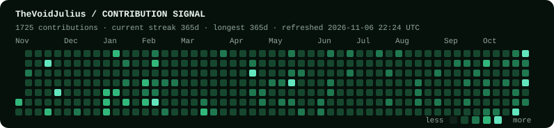

<table width="100%">
<tr>
<td width="24%" align="center" valign="middle"></td>
<td width="76%"></td>
</tr>
</table>

## TRANSMISSION

**Pushkar Panwar** · **TheVoidJulius**

I turn ideas into software—working across **Python, MERN, SQL, and AI/ML**. I care about the details people feel: the problem, the flow, the interface, and the thing that ships.

<b>More about the builder</b>

 

- **Mindset:** learn fast, build useful, iterate in public.
- **Current orbit:** full-stack products, applied AI, and experiments that make everyday workflows better.
- **Open to:** ambitious projects, hackathons, and collaborators who like shipping.

---

## FIELD NOTES // PROJECTS

<table>
<tr>
<td width="50%" valign="top">

### ◉ NIVARAN
**Right help. Right time.**

A need-first support-routing system designed around the challenges rural communities face across agriculture, healthcare, education, finance, and public services.

[Open the repository ↗](https://github.com/TheVoidJulius/Nivaran---Right-Time-Right-Help-)

</td>
<td width="50%" valign="top">

### ◉ ATTENDANCE PREDICTOR
**See the shortage before it becomes a problem.**

A student tool that calculates attendance and forecasts how many future classes are needed to recover. Built with Flask, MySQL, HTML, CSS, and JavaScript.

[Open the repository ↗](https://github.com/TheVoidJulius/Attendance-Shortage-Predictor---Minor-Project---I)

</td>
</tr>
<tr>
<td width="50%" valign="top">

### ◉ OVEX
**A live Next.js build.**

A deployed project from the web lab. Visit the live build or inspect the repository.

[Live demo ↗](https://ovex-seven.vercel.app/) · [Source ↗](https://github.com/TheVoidJulius/oveX)

</td>
<td width="50%" valign="top">

### ◉ MIDAS / FORAGE
**Engineering simulation.**

A project repository for the JPMC Advanced Software Engineering Forage program.

[Open the repository ↗](https://github.com/TheVoidJulius/forage-midas)

</td>
</tr>
</table>

---

## LOADOUT // TECH

**Languages & data:** Python · JavaScript · TypeScript · SQL  
**Web stack:** MERN · Flask · Next.js  
**Explore:** AI/ML · product engineering · computer vision

---

## THE READOUT // LIVE GITHUB DATA

<b>Open the live contribution grid</b>

 

The refresh is automated, not a claim of daily hand-written coding. GitHub’s own calendar supplies the numbers; the scheduled profile commit is identified as automation in the repository history.

<b>Unlock the trophy shelf</b>

 

---

## OPEN CHANNEL

Have a useful idea, an interesting problem, or a build that needs another brain? [Find me on GitHub](https://github.com/TheVoidJulius).

<table width="100%">
<tr>
<td width="90" align="center" valign="middle"></td>
<td></td>
</tr>
</table>

