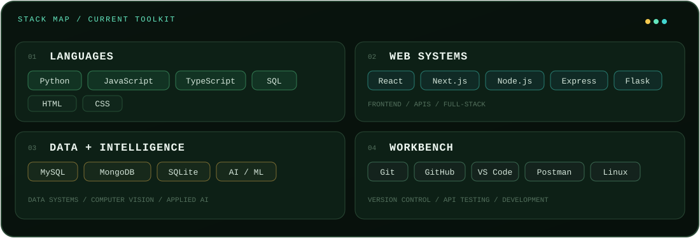
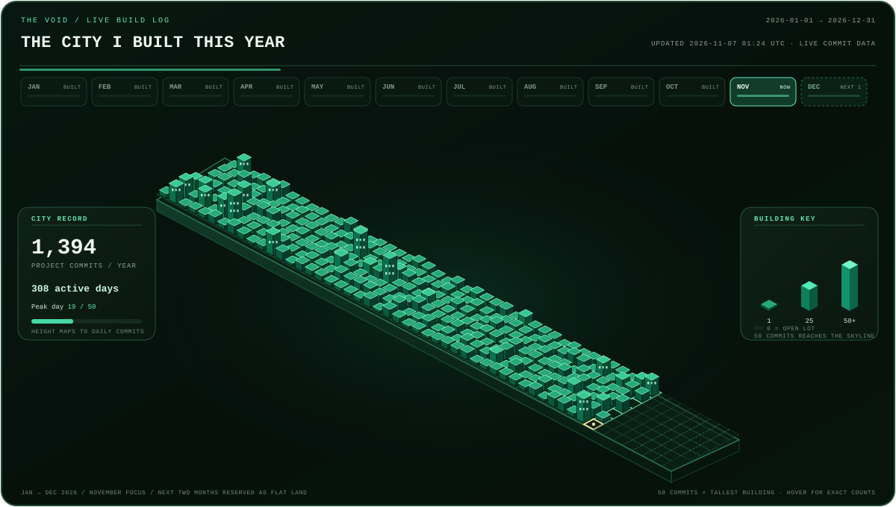
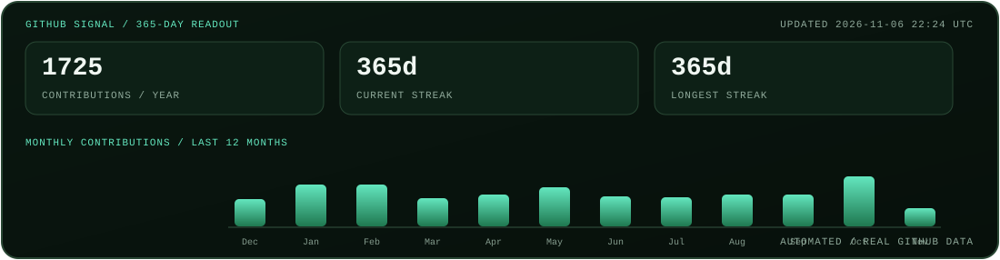

<table width="100%">
  <tr>
    <td width="22%" align="center" valign="middle">
      
    </td>
    <td width="78%">
      
    </td>
  </tr>
</table>

  
  
  
  

<a href="#projects">PROJECTS</a> &nbsp; / &nbsp; <a href="#proof--communities">PROOF + COMMUNITIES</a> &nbsp; / &nbsp; <a href="#toolkit">TOOLKIT</a> &nbsp; / &nbsp; <a href="#commit-city">COMMIT CITY</a> &nbsp; / &nbsp; <a href="#live-github-telemetry">LIVE TELEMETRY</a>

## SIGNAL / PROFILE

**Pushkar Panwar** · `TheVoidJulius`

I build software where useful ideas meet thoughtful engineering. My current orbit is **full-stack development, Python, SQL, and applied AI/ML**—from the first problem sketch to the interface and working product.

<table width="100%">
  <tr>
    <td width="33%" valign="top"><b>01 / BUILD</b> Product-minded web apps, practical tools, and experiments that solve a clear problem.</td>
    <td width="33%" valign="top"><b>02 / EXPLORE</b> Python · MERN · SQL · AI + ML · computer vision.</td>
    <td width="33%" valign="top"><b>03 / APPROACH</b> Learn quickly, build for people, iterate until the details land.</td>
  </tr>
</table>

  
<b>Open the extended field notes</b>

   

  - Interested in product engineering, applied AI, and tools that improve everyday workflows.
  - Open to ambitious projects, hackathons, and building with people who like shipping.
  - This page uses live GitHub data where available; program and community details below are profile-listed affiliations.

---

## PROJECTS

SELECTED BUILDS &nbsp; / &nbsp; FOUR SIGNALS FROM THE LAB

<table width="100%">
  <tr>
    <td width="50%" valign="top">
      
      
 

      **Need-first routing for real-world support.** Connects rural communities with relevant help across agriculture, health, education, finance, and public services.
    </td>
    <td width="50%" valign="top">
      
      
 

      **Know the attendance gap—and the recovery plan.** A student tool that calculates current attendance and required classes to get back on track.
    </td>
  </tr>
  <tr>
    <td width="50%" valign="top">
      
      
  &nbsp; <a href="https://ovex-seven.vercel.app/">OPEN LIVE BUILD ↗</a>

      **A deployed Next.js build.** Follow the project from source to the live experience.
    </td>
    <td width="50%" valign="top">
      
      
 

      **Engineering simulation.** Project repository for the JPMorgan Chase Advanced Software Engineering Forage program.
    </td>
  </tr>
</table>

<a href="https://github.com/TheVoidJulius?tab=repositories">OPEN THE FULL PROJECT INDEX ↗</a>

---

## PROOF / COMMUNITIES

<table width="100%">
  <tr>
    <td width="25%" valign="top"><b>GOOGLE</b> Gemini Ambassador</td>
    <td width="25%" valign="top"><b>MICROSOFT</b> Student Ambassador</td>
    <td width="25%" valign="top"><b>GSSoC ’26</b> Contributor</td>
    <td width="25%" valign="top"><b>COMMUNITY</b> TRYST · IIT Delhi Mediaverse</td>
  </tr>
</table>

PROFILE-LISTED PROGRAMS & COMMUNITIES &nbsp; / &nbsp; PROJECTS ABOVE LINK TO THEIR SOURCE

---

## TOOLKIT

WORKING MIX &nbsp; / &nbsp; PYTHON · MERN · SQL · AI/ML · PRODUCT ENGINEERING

---

## COMMIT CITY

JAN → DEC / CURRENT MONTH IN FOCUS / NEXT TWO MONTHS RESERVED AS FLAT LAND

The city runs from **January through December**, with the current month highlighted. The next two months stay as flat, reserved land until those dates arrive; past and current days grow a building from their real project commit count. **50 commits reaches the skyline cap**. Hover over a lot or tower for its date and exact count. GitHub is polled about every 15 minutes, with a full calendar-year reconciliation nightly at 03:07 UTC. This profile repository is excluded, so its own scheduled refreshes do not inflate the city.

---

## LIVE GITHUB TELEMETRY

  
<b>How the daily profile pulse works</b>

   

  The daily profile pulse fetches the contribution calendar and refreshes the heatmap and stats card. A separate city pulse checks daily commit counts about every 15 minutes and only commits when the city data changes. Both updates are labeled as automated profile maintenance in the commit history.

    
  Workflows: <a href="https://github.com/TheVoidJulius/TheVoidJulius/actions/workflows/profile-pulse.yml">profile-pulse.yml</a> (daily at 17:42 UTC) · <a href="https://github.com/TheVoidJulius/TheVoidJulius/actions/workflows/commit-city.yml">commit-city.yml</a> (about every 15 minutes plus a full-year sync at 03:07 UTC; GitHub may queue scheduled runs).

  The city uses commit contributions visible to GitHub. To include private-repository contribution counts, add a classic personal access token with `read:user` scope as the repository secret `PROFILE_STATS_TOKEN`; otherwise it uses the default repository token.

---

## OPEN CHANNEL

Have an interesting problem, a useful idea, or a build that needs another brain? <a href="https://github.com/TheVoidJulius">Find me on GitHub ↗</a>

<table width="100%">
  <tr>
    <td width="11%" align="center" valign="middle"></td>
    <td width="89%"></td>
  </tr>
</table>

END OF TRANSMISSION &nbsp; / &nbsp; THANKS FOR DROPPING IN

